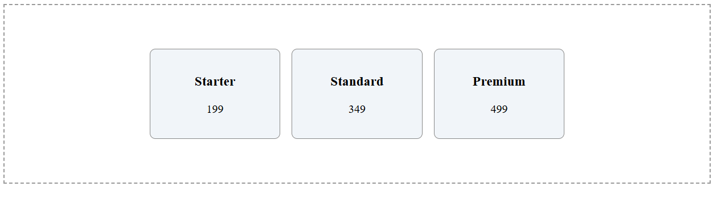
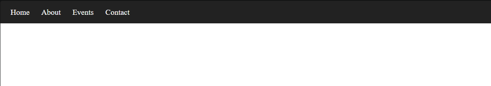
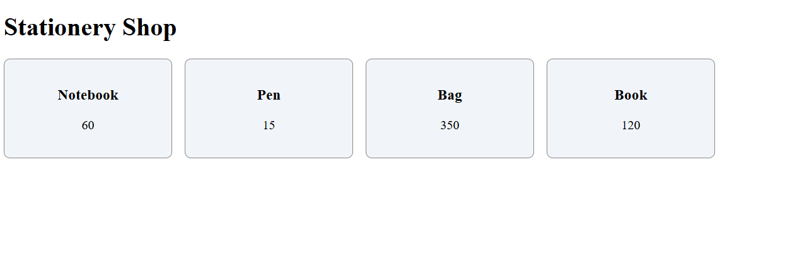

# Lab 13: Flexbox

**Name:** Anubhav Kumar  
**Roll No:** 2410303091  
**Course:** BCS554 - HTML & CSS Development Lab

## Aim
Practise the topic "Flexbox" through the three tasks of Assignment 13.

## Files
- `index.html` - opens the task pages
- `style.css` - styles for the index page
- `nav-flex.html` - Horizontal navigation bar
- `centred-cards.html` - Cards centred in both directions
- `wrapping-cards.html` - Cards that wrap onto new lines

## How to view
Open `index.html` in a browser and click each task link.

## Screenshot

