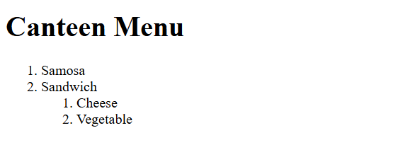
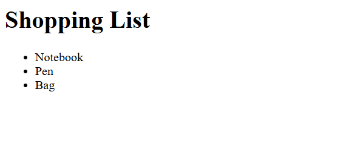

# Lab 6: Lists

**Name:** Anubhav Kumar  
**Roll No:** 2410303091  
**Course:** BCS554 - HTML & CSS Development Lab

## Aim
Practise the topic "Lists" through the three tasks of Assignment 6.

## Files
- `index.html` - opens the task pages
- `style.css` - styles for the index page
- `shopping-list.html` - Unordered list
- `canteen-menu.html` - Ordered list with a nested list
- `faq.html` - Description list

## How to view
Open `index.html` in a browser and click each task link.

## Screenshot

